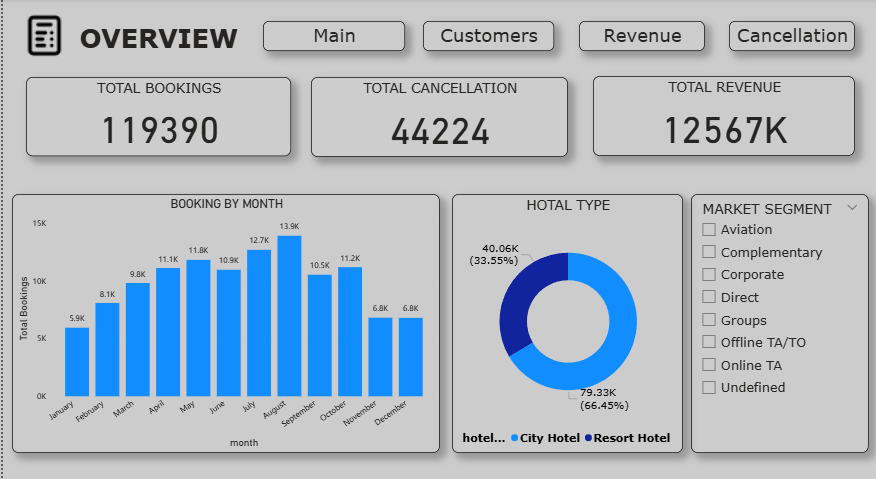
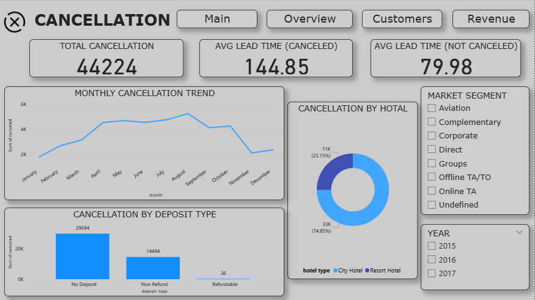
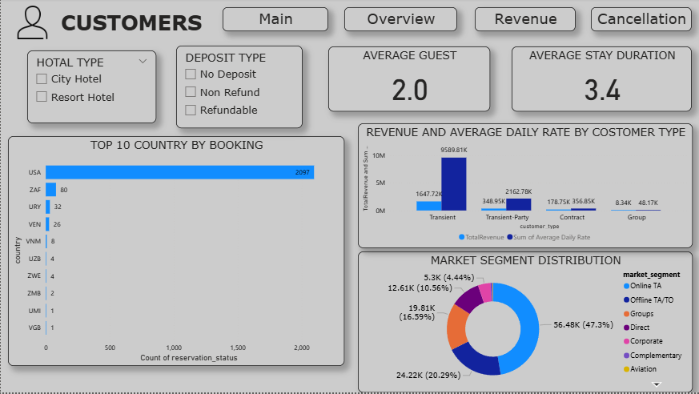
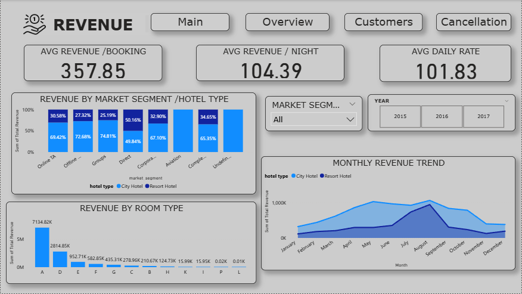

# Hotel Booking Analysis Dashboard

An easy-to-understand data analytics project that explores hotel booking data using **Power BI** and **Microsoft Excel**. The dashboards help users explore booking patterns, cancellations, customer segments, and revenue-related metrics.

## Project Preview

### Dashboard Overview

### Cancellation Analysis

### Customer Analysis

### Revenue Analysis

## Project at a Glance

- **Tools:** Power BI, Microsoft Excel
- **Dataset:** Hotel booking records
- **Main focus:** Booking trends, cancellations, customer patterns, and revenue-related analysis
- **Files included:** Power BI report, Excel workbook, and dashboard preview images

## Project Goals

1. Understand hotel booking trends.
2. Explore cancellations and compare booking outcomes.
3. Review customer and booking patterns.
4. Explore revenue-related metrics presented in the dashboard.
5. Communicate findings with clear charts and dashboard visuals.

## Key Questions Explored

- How do booking patterns change over time?
- How do City Hotels and Resort Hotels compare?
- What do cancellation patterns look like?
- Which customer or market segments contribute the most bookings?
- What trends are visible in the revenue-related dashboard?

## Files in This Repository

| File | What it is for |
|---|---|
| `Hotel Reservation Dashboard.pbix` | Interactive Power BI report. Open it with Power BI Desktop. |
| `Hotel_Booking_Insights_Dashboard.xlsx` | Excel workbook for exploring the data and analysis. |
| `dashboard_overview.png` | Preview of the main dashboard. |
| `dashboard_cancellation.png` | Preview of cancellation analysis. |
| `dashboard_customers.png` | Preview of customer analysis. |
| `dashboard_revenue.png` | Preview of revenue analysis. |

## How to Use the Project

### Open the Power BI dashboard
1. Download `Hotel Reservation Dashboard.pbix`.
2. Install or open **Power BI Desktop**.
3. Open the PBIX file.
4. Use the report tabs, filters, and slicers to explore the visuals.

### Open the Excel workbook
1. Download `Hotel_Booking_Insights_Dashboard.xlsx`.
2. Open it in Microsoft Excel.
3. Explore the available worksheets, tables, and charts.

## Tools and Skills Demonstrated

- Data analysis and exploration
- Excel-based data review
- Power BI dashboard development
- KPI and trend visualization
- Business insight communication

## Important Notes

- The dashboards show metrics based on the data and calculations included in the supplied project files.
- Do not interpret a revenue-related metric as audited financial revenue unless its calculation and currency are confirmed.
- A true hotel occupancy rate requires room-capacity or inventory data. Do not assume a booking count alone represents occupancy.

## Uploading to GitHub

1. Create a new GitHub repository.
2. Upload this `README.md`, the `.pbix` report, the `.xlsx` workbook, and all four PNG files.
3. Keep the README and PNG files in the same repository folder so the preview images display correctly.
4. Commit the files.

---
**Project:** Hotel Booking Analysis Dashboard  
**Tools:** Excel and Power BI
